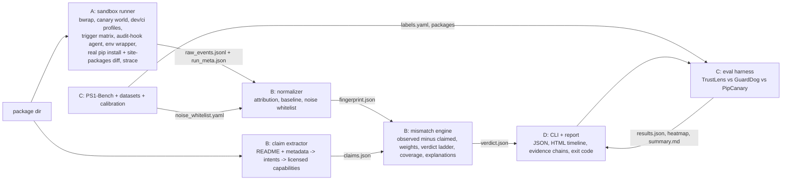

# AGENTS.md — master contract for every coding agent (and human) on TrustLens AI

> Paste-ready prompts live in `prompts/`. **This file wins over any prompt if they disagree** (tell the lead). Read it fully before writing code. ~10 minutes.

## 1. Goal

**TrustLens AI** answers PS1 *"Trust Nothing: Provenance for Your Own Dependencies"* for **Python (PyPI-style) packages**: given a package directory, run it **inside a no-network sandbox with fake secrets (canaries)**, record what it *actually does* in every phase (install / interpreter startup / import / call / CLI) under two environments (dev laptop vs CI), compare that behavior with what the package **says it does** (README + metadata), and output a verdict with an **evidence chain** and an honest **coverage block**. Rule-based, deterministic, offline. **No LLM in the verdict path.** Datasets are for *testing and calibration*, never training. npm is roadmap only.

Checkpoint 1 (tonight 9:30 PM): "install a package → get its fingerprint". It already works on fixtures: `make demo`.

Pitch claims (always prefix "to our knowledge"): (1) environment-differential execution (dev vs CI, +30-day clock); (2) startup-hook-aware real install (`.pth`/`sitecustomize`); (3) README-licensed behavior with evidence chains; (4) honest abstention + coverage block + our own benchmark (PS1-Bench) with CIs; (5) proof, not suspicion (canary-in-bytes).

## 2. Pipeline



## 3. Repo tree and ownership (strict; machine-readable in `OWNERS.yaml`)

```
trustlens/
  __init__.py, contracts.py        LEAD   (shared; contract-change PR only)
  sandbox/        runner.py fixture_runner.py live_probe.py env_check.py agent/{sitecustomize,harness}.py   A
  claims/         extract.py                                                                              B
  fingerprint/    normalize.py static_signals.py                                                          B
  engine/         evaluate.py weights.yaml noise_whitelist.yaml                                           B
  report/         html.py text.py                                                                         D
  webui/          (optional P2) localhost upload-and-scan page, stdlib only                               D
  cli.py __main__.py                                                                                      D
bench/            packages/{malicious,clean}/ labels.yaml tools/ calibration/                             C
eval/             run_eval.py metrics.py heatmap.py baselines/                                            C
data/             (gitignored) datasets, malware zips                                                     C
schemas/          *.schema.json capabilities.yaml examples/<pkg>/…                                        LEAD
scripts/          check_env.sh (A) · fetch_*.sh extract_in_sandbox.sh (C) · audit.sh audit_contracts.py make_examples.py check_ownership.py scan_secrets.sh build_kit.sh (LEAD)
tests/            sandbox/ (A) engine/ (B) bench/ (C) e2e/ (D) contracts/ (LEAD)
docs/             CONTRACTS.md (LEAD) · ARCHITECTURE LIMITATIONS DEMO_SCRIPT PPT_OUTLINE PLAN (D) · SANDBOX (A) ENGINE (B) DATASETS (C)
prompts/ AGENTS.md AUDIT.md OWNERS.yaml DEPENDENCIES.md pyproject.toml requirements*.txt   LEAD
Makefile README.md reports/                                                                             D
```
| Dev | Owns | Produces | Branch prefix |
|---|---|---|---|
| **A** | `trustlens/sandbox/**`, `scripts/check_env.sh`, `tests/sandbox/**`, `docs/SANDBOX.md` | raw events + run_meta | `dev-a/…` |
| **B** | `trustlens/{claims,fingerprint,engine}/**`, `tests/engine/**`, `docs/ENGINE.md` | claims, fingerprint, verdict | `dev-b/…` |
| **C** | `bench/**`, `eval/**`, `scripts/fetch_*.sh`, `scripts/extract_in_sandbox.sh`, `data/**`, `tests/bench/**`, `docs/DATASETS.md` | labels, packages, results, whitelist | `dev-c/…` |
| **D** | `trustlens/cli.py`, `trustlens/report/**`, `trustlens/webui/**` (optional), `tests/e2e/**`, `Makefile`, `README.md`, `docs/{ARCHITECTURE,LIMITATIONS,DEMO_SCRIPT,PPT_OUTLINE,PLAN}.md` | CLI, reports, demo, deck | `dev-d/…` |
| **Lead** | everything marked LEAD | contracts, merges, audit | `lead/…` |

## 4. Frozen interfaces (summary; the authority is `docs/CONTRACTS.md` + `schemas/`)

```python
run_package(pkg_path, out_dir, *, profiles=("dev","ci"), triggers=DEFAULT_TRIGGERS, offline=True, timeout_s=120, runner="auto") -> {"raw_events_path","run_meta_path","run_meta"}   # A
extract_claims(pkg_path) -> claims.json dict                                                                                                       # B
build_fingerprint(raw_events_path, run_meta, package, static_signals=None, whitelist=None) -> fingerprint.json dict                                   # B
evaluate(fingerprint, claims) -> verdict.json dict                                                                                                  # B
scan(pkg_path, out_dir, *, runner="auto", profiles=("dev","ci"), offline=True, static=False, check_contracts=True) -> {verdict,fingerprint,claims,out_dir}  # D
python -m eval.run_eval --runner fixture|live --tools trustlens,guarddog,pipcanary                                                                 # C
CLI exit codes: 0 PASS · 10 REVIEW · 20 BLOCK · 2 error
```
Verdict ladder: `MALICIOUS-EVIDENT`(BLOCK) · `SUSPICIOUS`(REVIEW) · `INCONCLUSIVE`(REVIEW) · `BENIGN-CONSISTENT`(PASS). BLOCK needs canary-in-bytes OR ≥ 2 independent strong signal classes. No run ⇒ INCONCLUSIVE, never PASS.

**You may call another dev's public function; you may never edit their file.** Need a change? §6.

## 5. Coding standards

* Python ≥ 3.11 (3.13 verified). Type hints on public functions. Docstring first line = purpose. Standard library + `requirements.txt` only; a new dependency needs lead approval (DEPENDENCIES.md + pin).
* `ruff check .` clean (config in `pyproject.toml`). Tests with `pytest`; **every bug you fix gets a regression test**; every new rule/trigger gets a fixture.
* Deterministic outputs (sorted keys/lists). No wall-clock, randomness, or network in verdict logic. UTC ISO-8601 timestamps.
* Treat package content as hostile data: escape on output, never `eval`/`shell=True` on it, never path-join untrusted names without a check.
* Every stub says `STUB` in its docstring and `# TODO(dev-X, P#)`; replacing a stub keeps the signature.
* Small files, small functions, no frameworks. Prefer boring. No clever metaprogramming.
* Honesty in output: unknown ⇒ say unknown. Every limitation you hit goes into `run_meta.coverage.not_observed` (A) or `docs/LIMITATIONS.md` (tell D).

## 6. Parallel-work rules (this is how we avoid merge conflicts)

1. **Edit only files you own** (§3 / `OWNERS.yaml`). `python scripts/check_ownership.py --dev <a|b|c|d>` must pass before every push. Do not "quickly fix" a neighbour's bug: write a failing test **in your own tests folder** (or a one-line issue) and message the owner.
2. **Shared files** (contracts, schemas, capabilities, pyproject, requirements, AGENTS.md) change **only via a contract-change PR** to the lead (process: `docs/CONTRACTS.md` §9). Prefer additive optional fields. Never rename/remove.
3. Branches: `dev-a/<topic>`, `dev-b/<topic>`, `dev-c/<topic>`, `dev-d/<topic>`, `lead/<topic>`; one topic per branch (`dev-a/real-install`). Branch from latest `main`. PRs ≤ ~300 changed lines where possible; **merge to `main` at least every 60–90 min**, at hand-off points and checkpoints.
4. **Rebase, don't merge main into your branch**: `git fetch && git rebase origin/main` before each push; conflicts should be impossible if you followed rule 1 — if one appears, stop and tell the lead.
5. Commit messages: `<area>: <imperative summary>` where area ∈ `sandbox|claims|fingerprint|engine|report|cli|bench|eval|data|docs|tests|contract|audit` — e.g. `sandbox: capture .pth files after real install`. Body: why + how verified (`make test` output line). Never commit `data/`, zips, venvs, reports, tokens.
6. **No big refactors, no renames, no reformatting of files you don't own, no new top-level folders.** If your design needs one, ask the lead first.
7. Keep `make demo` and `make test` green on `main` at all times. Red `main` ⇒ the last merger fixes or reverts within 10 minutes.
8. AI-agent hygiene: give your coding agent your prompt file + this file; tell it to run `make test` and `python scripts/check_ownership.py --dev X` after each task and to stop and ask if a task needs a file it does not own. Review generated diffs: no new network calls, no `shell=True`, no deleted tests.

## 7. Safety rules (non-negotiable)

* **Malware is data.** Samples live only under `data/` (gitignored). They are executed **only inside the bwrap sandbox with network off** (`--unshare-net --unshare-pid --clearenv --die-with-parent`, fake HOME, canaries only — never real credentials, never the real HOME, never the real `/etc`). Never `pip install`, `python setup.py`, `import`, or double-click a sample on the host. Never `pip download` untrusted names (use the PyPI JSON API + sha256 + safe extract, see `bench/tools/pick_clean.py`).
* Extract password-protected zips (`infected`) **inside the sandbox** (`scripts/extract_in_sandbox.sh`).
* Do not post, upload, or share sample contents. Do not run samples on university/shared Wi-Fi without the network-block self-test (`scripts/check_env.sh` prints "network really blocked: YES").
* **Never install `supply-chain-guard` from PyPI.** That PyPI name is a *different*, hostile-looking project (namesjoe/chain_guard; ships a `.pth`). The real supply-chain-guard is an npm tool (homeofe). We do not use it.
* If the sandbox cannot be verified on your machine, do **not** run samples live; use `--runner fixture` and Docker (`--network none`) or another teammate's machine.
* `--offline` is the default posture: no external services, no telemetry, no LLM/API calls from product code.
* Generated planted toys are synthetic: RFC 5737 / `.invalid` targets only; never real hosts.

## 8. Licensing rules

| Source | License | Our use |
|---|---|---|
| **Packj** | **AGPL-3.0** | **Never copy, vendor, import or adapt its code or rules.** May be run as a separate CLI process for comparison only (`eval/baselines`). |
| OSCAR (paper) | no code published | ideas only; reimplement from the paper; cite. |
| Package Analysis (OpenSSF) | Apache-2.0 | ideas/code OK **with attribution** (comment + `NOTICE`). |
| GuardDog | Apache-2.0 | optional baseline CLI; may read rules for ideas; attribute if copied. |
| PipCanary | MIT | optional baseline CLI; keep copyright if copied. |
| Datadog malicious-software-packages-dataset | Apache-2.0 | test sample only; do not redistribute zips. |
| QUT-DV25 / OSPtrack | see record / CC-BY-4.0 | calibration only; cite. |
| pypi_malregistry | **no license** | local backup only; never commit/redistribute. |
Our own code is MIT. New dependency ⇒ add row to `DEPENDENCIES.md` with license; no GPL/AGPL deps (`make audit` flags them).

## 9. Do-not-claim list (slides, README, talking points, code comments, report text)

* ❌ "first sandbox-based detector" (PipCanary exists) · ❌ "first false-positive reduction" or "first evaluation suite" (GuardDog 3.x) · ❌ "nobody compares code with its claims" (SemanticSentinel and others exist) · ❌ "100% / zero false positives" (we have `0/N`, CI up to ~20% at N=15) · ❌ "detects all malware" / "safe" (we say *consistent with stated purpose within coverage*) · ❌ anything about npm as implemented (roadmap) · ❌ "trained on QUT/Datadog" (calibration/testing only) · ❌ numbers not in `reports/eval/results.json`.
* ✅ Use: "to our knowledge", "environment-differential execution", "startup-hook-aware real install", "README-licensed behavior with evidence chains", "honest abstention (INCONCLUSIVE) with a coverage block", "own benchmark PS1-Bench + external samples", "proof, not suspicion".
* `make audit` greps pitch docs for banned phrases. `schemas/examples/_synthetic_*` and any stub are labelled as such in every demo.

## 10. Definition of done (per task, then per dev)

A task is done when: (1) acceptance criteria in your prompt pass; (2) `make test` and `ruff check .` green; (3) golden fixture(s) updated/added through the right channel; (4) `python scripts/check_ownership.py --dev X` clean; (5) merged to `main` by rebase PR; (6) `make demo` still prints 4 verdicts; (7) AUDIT.md rows for your area ticked with date/time in the log.
Per dev: all P0 tasks merged by H+8, P1 by H+16, P2 only if time; final freeze at H+21 (bug fixes only); signed off in AUDIT.md §9.

## 11. Commands

```bash
make setup-dev        # venv + pinned deps (incl. GuardDog/PipCanary baselines)
bash scripts/check_env.sh      # FIRST: can this laptop run bwrap rootless + no-net? (Ubuntu 24.04 may block userns)
make demo             # end-to-end on fixtures -> reports/demo/*/report.html
make test             # pytest + contract audit        make lint   # ruff
make eval             # PS1-Bench metrics + heatmap -> reports/eval/    (make eval-live for real sandbox)
make audit            # automated AUDIT.md checks      python scripts/check_ownership.py --dev a
python -m trustlens scan bench/packages/malicious/evil_slug --runner live     # real bwrap run on a toy
```
